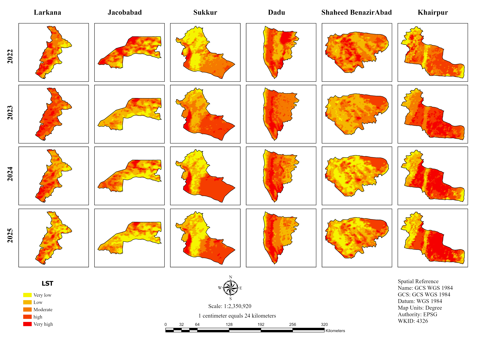
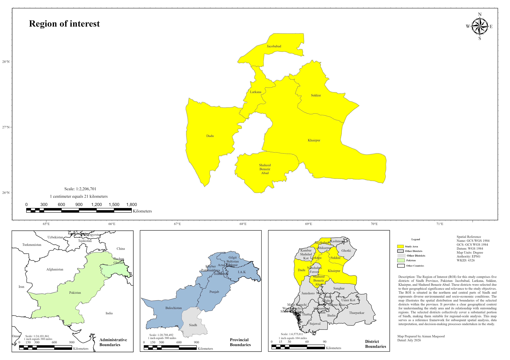
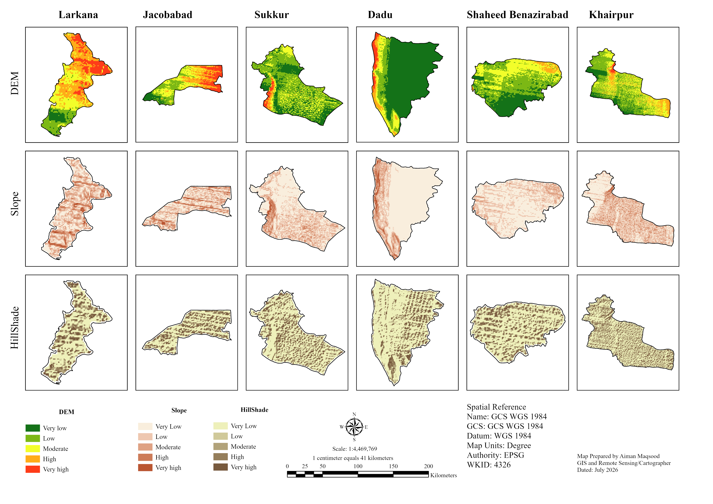

# Post-Monsoon Nighttime Land Surface Temperature and Terrain Influences, Six Districts of Sindh, Pakistan (2022-2025)

## Overview
Multi-year GIS analysis of post-monsoon (October and November) nighttime Land Surface Temperature (LST) and its relationship with terrain in six districts of Sindh: Larkana, Jacobabad, Dadu, Khairpur, Shaheed Benazirabad and Sukkur. Elevation, slope and hillshade were derived from a DEM to examine how topography relates to nighttime thermal patterns.

## Study area
Six districts of Sindh Province, Pakistan: Larkana, Jacobabad, Dadu, Khairpur, Shaheed Benazirabad and Sukkur.

## Data
- Nighttime LST: [product, e.g. MODIS MOD11A2 / Landsat, and resolution], October and November, 2022-2025
- DEM: [USGS SRTM (GTOPO), e.g. SRTM, and 1km]
- District boundaries:

## Method
1. Prepared nighttime LST rasters for October and November of each year (2022-2025) [state how they were obtained and processed, e.g. GEE, unit conversion to °C].
2. Used raster math in ArcGIS Pro to calculate monthly and seasonal mean composites.
3. Derived **slope** and **hillshade** surfaces from the DEM to describe terrain relief and roughness.
4. Organized all rasters and district boundaries in a standard geodatabase.
5. Built layout series showing elevation, slope, hillshade and nighttime LST for each of the six districts.

## Results

### Elevation

### Nighttime LST (post-monsoon mean)

### Key findings
- [Range of mean nighttime LST across the six districts, in °C, with the warmest and coolest district]
- [How nighttime LST relates to elevation, for example whether lower areas are cooler or warmer, with one district as an example]
- [Any link between terrain (slope or relief) and thermal patterns]

## Tools
ArcGIS Pro (raster math, slope, hillshade, layout design (https://code.earthengine.google.com/2fe343076c6df368bf81ea1a3e0f31ca) Code for LST data

## Files
- `StudyArea.png`: study area map
- `ElevationMap.png`: elevation maps for the six districts
- `NightPostLST.png`: post-monsoon nighttime LST maps
- `SindhROI.ppkx`, `panel_map.ppkx`, 'NIGHTPOSTLST.ppkg': ArcGIS Pro project packages (open in ArcGIS Pro only)

## Limitations
- [LST product resolution compared with district size]
- Only October and November are covered, so results do not describe other seasons.
